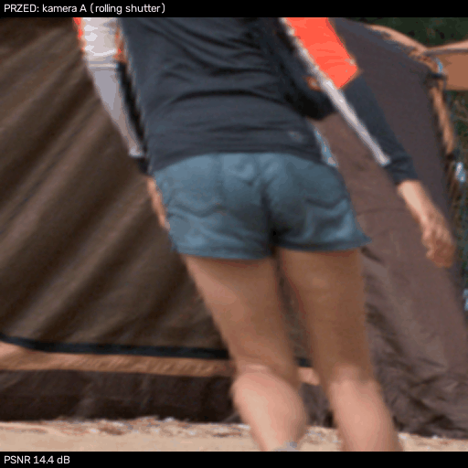
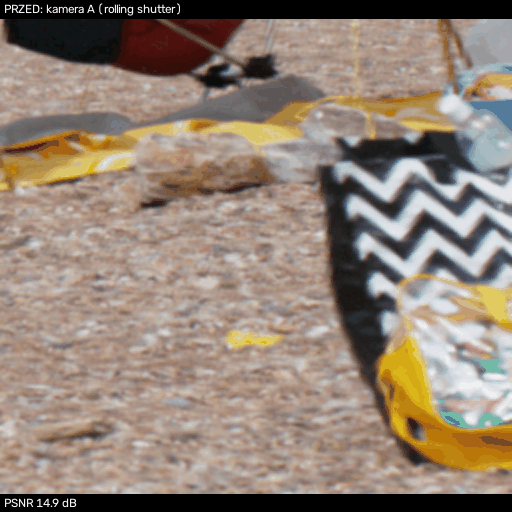
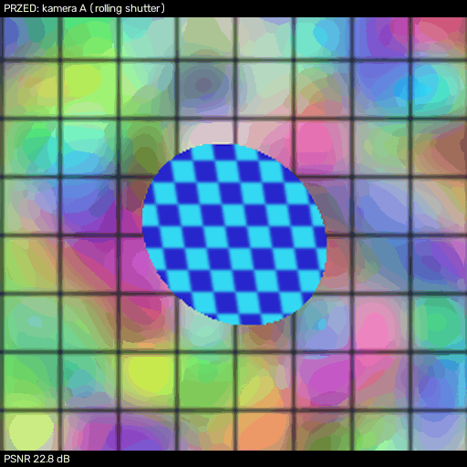
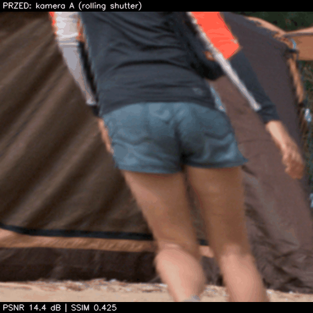
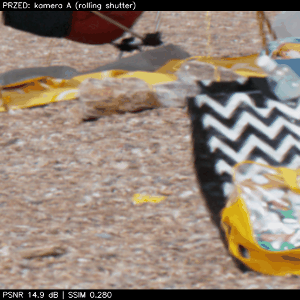
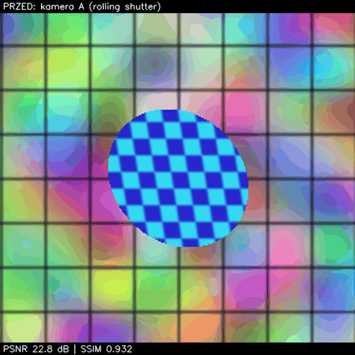
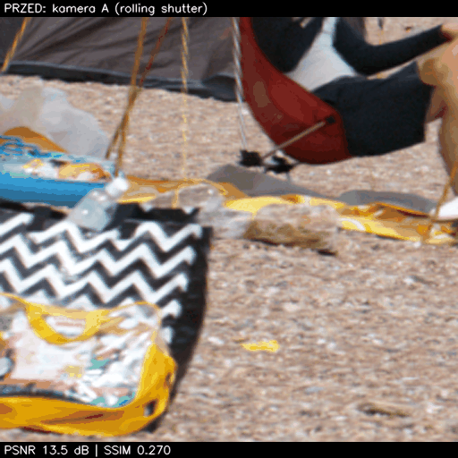
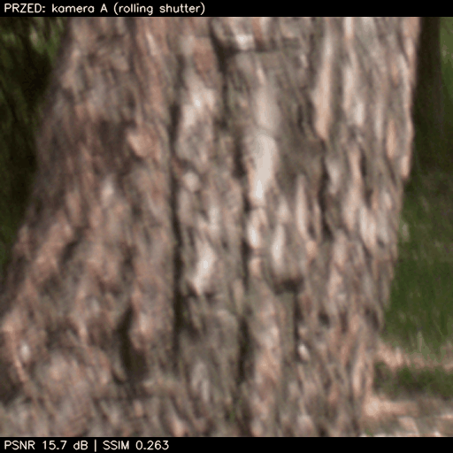
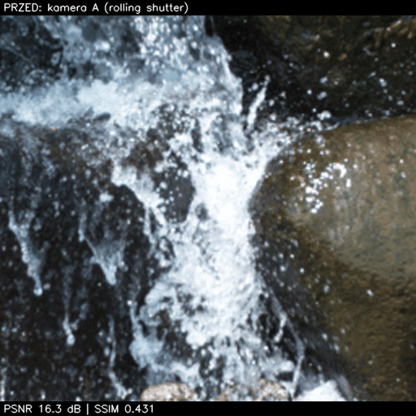
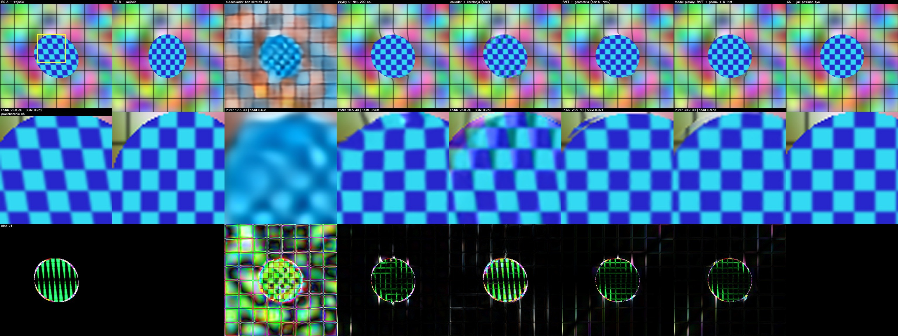

# Kompensacja rolling shutter z dwóch prostopadłych kamer: podsumowanie badań

*Stan na 16.11.2026. Wszystkie wyniki: zbiór walidacyjny `rs_video_x4k` (321 próbek z 13 scen, których nie było w treningu), obrazy 256×256.*

## 1. Problem i pomysł

Kamera z migawką szczelinową (rolling shutter, RS) czyta obraz wiersz po wierszu. Odczyt całej klatki trwa 10–30 ms,
więc ruchome obiekty wychodzą pochylone lub rozciągnięte. Stosujemy dwie kamery RS obok siebie. Kamera B jest obrócona
o 90°, więc w kadrze kamery A czyta kolumny zamiast wierszy. Ten sam punkt sceny każda kamera rejestruje w innej, znanej
chwili, wynikającej z numeru wiersza (A) i kolumny (B). Z pary obrazów (A, B) chcemy odtworzyć obraz kamery A taki,
jakby cała klatka powstała w jednej chwili (global shutter, GS).

## 2. Dane

Zbiór `rs_video_x4k` składamy z nagrań 1000 kl./s (X4K1000FPS, 110 scen plenerowych):
- wiersz *y* obrazu A pochodzi z klatki nagranej w chwili jego odczytu, a kolumna *x* obrazu B z klatki nagranej w chwili odczytu tej kolumny
  (interpolacja liniowa między klatkami co 1 ms); wzorzec GS to jedna klatka ze środka odczytu A;
- czas odczytu 10–30 ms, przesunięcie startu kamery B ±2 ms, odległość kamer (baza) 0–8 px, wzmocnienie 0,9–1,1, szum σ ≤ 0,01;
- **2397 próbek treningowych (97 scen) i 321 walidacyjnych (13 scen)**, podział po scenach.

Ruch obejmuje zarówno ruch kamery, jak i ruch obiektów. Około 1/3 próbek ma słaby RS, dlatego obraz wejściowy ma już średnio 26,35 dB.

## 3. Badane metody

**A. RAFT + geometria RS (metoda jawna).**
1. RAFT (gotowa sieć przepływu optycznego, torchvision `raft_large`) dla każdego piksela obrazu A znajduje ten sam punkt w obrazie B.
2. Geometria (stałe obliczenia bez uczonych wag) dzieli to przesunięcie przez różnicę chwil odczytu obu kamer,
   co daje prędkość każdego piksela. Potem cofa każdy piksel A do wspólnej chwili *t* = 0.
3. Geometria jest różniczkowalna, więc RAFT można dostroić stratą L1 obrazu wynikowego względem wzorca GS.
   Geometria v2 dodatkowo poprawia krawędzie ruchomych obiektów: miejsca zasłonięte w kamerze A bierze z kamery B.

**B. Model główny: RAFT + geometria + U-Net.** Mała sieć U-Net (2,7 mln wag) dostaje obrazy A i B przesunięte geometrią
do chwili *t* = 0. Poprawia oba pola przesunięć o kilka pikseli, dobiera dla każdego piksela proporcję A i B (maska)
i dodaje drobną poprawkę jasności. Uczenie: 30 epok U-Netu przy zamrożonym RAFT, potem 10 epok wspólnego dostrajania.

**C. Sieci bez geometrii (synteza obrazu wprost).** Dostają A, B, współrzędne i mapy czasów odczytu obu kamer, a korekcji muszą się nauczyć same:
- autoenkoder bez połączeń skrótowych (`ae`, wąskie gardło 16×16×512),
- zwykły U-Net (przewiduje przesunięcie obrazu A i poprawkę jasności),
- syjamski enkoder z warstwą korelacji A↔B i dekoder ze skrótami (`corr`), wynik = A + poprawka.

Wszystkie sieci uczone od zera: bs 16, lr 3·10⁻⁴, harmonogram OneCycle.

## 4. Wyniki

Wszystkie metody oceniono tym samym skryptem i tą samą miarą: **PSNR / SSIM całego obrazu**, uśrednione po obrazach.
CI95 to bootstrap po scenach. Różnica jest sparowana, czyli liczona na tych samych próbkach co model główny.

| metoda | PSNR [dB] | CI95 (sceny) | SSIM | różnica vs model główny [dB] (CI95) | param. [M] | kroki uczenia | ms/parę (L4) |
|---|---|---|---|---|---|---|---|
| bez korekcji (obraz A) | 26,35 | [23,51; 28,96] | 0,797 | −9,02 [−10,84; −7,32] | – | – | – |
| sam obraz B | 19,50 | [18,59; 20,52] | 0,575 | −15,87 [−17,00; −14,24] | – | – | – |
| średnia A i B | 23,47 | [22,06; 24,85] | 0,740 | −11,90 [−12,79; −10,57] | – | – | – |
| *sieci bez geometrii* | | | | | | | |
| autoenkoder bez skrótów (`ae`), 60 ep. | 23,27 | [22,20; 24,31] | 0,681 | −12,09 [−13,26; −10,51] | 10,2 | 8 940 | 4,4 |
| zwykły U-Net, 30 ep. | 28,42 | [26,01; 30,52] | 0,846 | −6,95 [−8,36; −5,65] | 2,72 | 4 470 | 4,3 |
| zwykły U-Net, 200 ep. | 30,94 | [28,40; 33,17] | 0,895 | −4,42 [−5,64; −3,43] | 2,72 | 29 800 | 4,3 |
| enkoder + korelacja (`corr`), 80 ep. | 31,06 | [28,63; 33,25] | 0,887 | −4,31 [−5,53; −3,22] | 6,24 | 11 920 | 11,3 |
| *RAFT + geometria* | | | | | | | |
| RAFT gotowy + geometria v1 | 32,34 | [30,42; 34,05] | 0,933 | −3,03 [−3,59; −2,57] | 5,26 | 0* | 48 |
| RAFT gotowy + geometria v2 | 32,81 | [30,94; 34,44] | 0,936 | −2,56 [−2,97; −2,19] | 5,26 | 0* | 59 |
| RAFT dostrojony + geometria v1 | 33,60 | [31,58; 35,33] | 0,938 | −1,77 [−2,00; −1,56] | 5,26 | 2 990 | 48 |
| RAFT dostrojony z v2 + geometria v2 | 33,89 | [31,93; 35,54] | 0,940 | −1,48 [−1,68; −1,32] | 5,26 | 4 485 | 60 |
| *RAFT + geometria + U-Net* | | | | | | | |
| RAFT (zamrożony) + geometria + U-Net | 35,24 | [33,29; 36,91] | 0,953 | −0,13 [−0,16; −0,10] | 7,98 | 8 970 (+4 485) | 56 |
| **model główny: wspólnie dostrojone** | **35,37** | [33,41; 37,04] | **0,954** | – | 7,98 | 2 990 (+13 455) | 56 |

\* bez uczenia na naszych danych (RAFT wstępnie wytrenowany na publicznych zbiorach przepływu optycznego).

**Najważniejsze liczby:**
- Model główny poprawia obraz o **+9,0 dB** (26,35 → 35,37 dB) i jest lepszy od wejścia w 313 z 321 próbek.
- U-Net w modelu głównym dodaje **+1,45 dB** [1,28; 1,65] względem etapu RAFT + geometria tego samego modelu i poprawia 303 z 321 próbek.
- Gotowy RAFT z geometrią, bez uczenia na naszych danych (32,34–32,81 dB), daje więcej niż każda sieć bez geometrii (najlepsza: 31,06 dB po 11 920 krokach).
  Przedziały po scenach tych dwóch grup częściowo się nakładają, bo sceny bardzo różnią się trudnością.
  Po dostrojeniu RAFT (33,60–33,89 dB) przewaga jest wyraźna: różnice względem modelu głównego wynoszą −1,48 [−1,68; −1,32] i −4,31 [−5,53; −3,22] dB, a ich przedziały są rozłączne.

### Wynik w podziale na siłę rolling shuttera

Klasy według 95. percentyla przesunięcia pikseli przez RS. *Miara: PSNR na obszarze widocznym w kamerze A (wcześniejsza miara, liczby nieco wyższe niż w tabeli głównej).*

| siła RS | próbek | wejście | zwykły U-Net (30 ep.) | RAFT gotowy + geometria v1 | RAFT dostrojony + geometria (etap modelu głównego) | **model główny** | zysk modelu głównego |
|---|---|---|---|---|---|---|---|
| słaby (< 2 px) | 115 | 32,82 | 33,58 | 35,72 | 36,58 | **38,18** | +5,4 |
| średni (2–6 px) | 104 | 25,84 | 28,05 | 32,64 | 34,29 | **35,76** | +9,9 |
| silny (≥ 6 px) | 102 | 19,78 | 23,08 | 29,85 | 31,93 | **33,20** | +13,4 |

Im silniejszy RS, tym większy zysk. U-Net na końcu dodaje podobnie w każdej klasie (+1,3 do +1,6 dB), czyli poprawia drobne błędy, które zostają po geometrii.

## 5. Ablacje

**Kamera B jest konieczna.** Zwykły U-Net (200 epok), w którym obraz B zastąpiono kopią A, osiąga 26,51 dB (wejście 26,35, czyli +0,16 dB).
Ta sama sieć z kamerą B osiąga 30,94 dB (+4,59 dB).

**Model z geometrią korzysta z różnicy chwil odczytu, sieć bez geometrii nie.** Zysk względem wejścia w funkcji |t_B − t_A|
(chwile odczytu danego piksela w obu kamerach). *Miara: PSNR z MSE zsumowanego po pikselach z |t_A| ≥ 5 ms, nieporównywalny wprost z tabelą główną.*

| abs(t_B − t_A) [ms] | ~1 | ~3 | ~5 | ~7,5 | ~10,5 | ~14 | ~18 | ~25,5 |
|---|---|---|---|---|---|---|---|---|
| zwykły U-Net, tylko A | +0,31 | +0,30 | +0,31 | +0,31 | +0,31 | +0,30 | +0,33 | +0,29 |
| zwykły U-Net, A + B | +5,15 | +5,61 | +5,66 | +4,85 | +4,59 | +4,02 | +3,93 | +3,67 |
| model główny | +6,82 | +8,22 | +11,48 | +13,56 | +13,79 | +11,69 | +11,82 | +11,53 |

Zysk modelu głównego rośnie z +6,8 dB tam, gdzie obie kamery czytają piksel prawie jednocześnie (prędkości nie da się wtedy zmierzyć),
do ok. +13,7 dB przy różnicy 7,5–10,5 ms. Pomiar potwierdza zasadę prostopadłego odczytu. Zysk zwykłego U-Netu z kamery B
lekko maleje z różnicą chwil odczytu: sieć traktuje B jako drugi, inaczej zniekształcony widok sceny, a nie jako pomiar ruchu w czasie.

**Długość uczenia sieci bez geometrii.** Zwykły U-Net: 28,42 dB po 30 epokach, 30,94 dB po 200 epokach, plateau od ok. 100. epoki.
`corr`: w ostatnich 20 z 80 epok przyrost +0,1 dB. Wszystkie trzy architektury zatrzymują się na poziomie ≤ 31 dB.

## 6. Wnioski

1. **Jawna geometria czasu odczytu daje większość zysku.** RAFT + geometria bez uczenia na naszych danych przewyższa każdą sieć syntetyzującą obraz wprost,
   także uczoną 200 epok. Dostrojenie RAFT przez geometrię dodaje ok. 1,3 dB i nasyca się po kilku epokach.
2. **Model główny (RAFT + geometria + U-Net) osiąga 35,37 dB (+9,0 dB względem wejścia).** U-Net usuwa szew między obrazami z kamer A i B,
   wygładza krawędzie obiektów i odtwarza brzegi kadru widoczne tylko w kamerze B.
3. **Sieci bez geometrii zatrzymują się na ok. 31 dB** niezależnie od architektury i liczby parametrów (2,7–10,2 mln). Autoenkoder bez skrótów
   daje wynik gorszy od wejścia (23,27 dB), bo wąskie gardło rozmywa obraz.
4. **Kamera B jest konieczna**, a z jej informacji korzysta tylko model, który jawnie dzieli przesunięcie przez różnicę chwil odczytu.
5. Hierarchia metod jest pewna mimo tylko 13 scen walidacyjnych: wszystkie różnice sparowane względem modelu głównego mają CI95 z dala od zera.

## 7. Ograniczenia

- **Dane syntetyczne**: brak paralaksy zależnej od głębi, brak rozmycia ruchu, mały zakres przesunięcia startu kamer (±2 ms). Zbiór prawie nie ma ruchu obrotowego.
- **Brak osobnego zbioru testowego**: najlepsza epoka wybierana na walidacji. Walidacja to tylko 13 scen, stąd szerokie przedziały po scenach.
- **Szum jest dodany tylko do wejścia**, a wzorzec jest czysty, więc część zysku U-Netu może być odszumianiem.
- **Pas na antyprzekątnej kadru**: tam obie kamery czytają punkt w tej samej chwili, więc prędkość jest uzupełniana z sąsiedztwa.
  Miejsca niewidziane przez żadną kamerę (wąski pas przy krawędzi szybkiego obiektu) zostają błędne.
- **Ruch jednostajny w czasie odczytu**: geometria zakłada ruch po prostej; przy szybkim obrocie (wiatrak) to założenie przestaje obowiązywać.
- **Rozdzielenie wkładu geometrii i pretreningu RAFT**: próba zastąpienia RAFT własną siecią przepływu uczoną od zera była niestabilna numerycznie
  i nie została ukończona.
- Nierówne budżety uczenia między metodami (kolumna „kroki uczenia”).

## 8. Dalsze prace

- Zbiór rozszerzony: X4K + zbiór warstwowy (paralaksa, zasłonięcia, większe przesunięcia), te same modele przy tej samej liczbie kroków.
  Pytanie: kto zyskuje więcej na bogatszych danych, model z geometrią czy synteza wprost. Treningi w toku.
- U-Net korzystający z geometrii v2 (dziś v1).
- Test na parze prawdziwych kamer (wiatrak) ze stanowiska.

## Demo

Model główny (wspólnie dostrojony). Więcej przykładów: [`docs/wyniki_2026-11-08/`](../wyniki_2026-11-08/README.md).

| idąca osoba (`val/00276_02`) | torba (`val/00273_02`) | syntetyczne koło |
|---|---|---|
|  |  |  |

GIF-y pokazują kolejno: obraz z kamery A → wynik bez U-Netu → wynik modelu głównego.

### Demo: sieci bez geometrii kontra model główny

GIF-y pokazują kolejno: obraz z kamery A → autoenkoder bez skrótów → zwykły U-Net (200 ep.) → enkoder + korelacja (`corr`) → model główny.
Każda klatka trwa 2 s. Pod każdym obrazem jest PSNR i SSIM całego obrazu, liczone tymi samymi funkcjami co w tabeli głównej.

Te same próbki co wyżej:

| idąca osoba (`val/00276_02`) | torba (`val/00273_02`) | syntetyczne koło |
|---|---|---|
|  |  |  |

Próbki walidacyjne z najsilniejszym RS (najniższy PSNR wejścia):

| torba, inna próbka (`val/00273_01`) | kora drzewa (`val/00839_01`) | wodospad (`val/00823_02`) |
|---|---|---|
|  |  |  |

PSNR [dB] / SSIM całego obrazu:

| próbka | wejście (A) | autoenkoder | zwykły U-Net | `corr` | RAFT + geometria (bez U-Netu) | model główny |
|---|---|---|---|---|---|---|
| idąca osoba (`00276_02`) | 14,4 / 0,425 | 17,0 / 0,531 | 18,0 / 0,570 | 19,9 / 0,639 | 28,3 / 0,880 | **31,9 / 0,924** |
| torba (`00273_02`) | 14,9 / 0,280 | 17,0 / 0,347 | 18,7 / 0,546 | 19,5 / 0,537 | 26,2 / 0,886 | **30,7 / 0,926** |
| syntetyczne koło | 22,8 / 0,932 | 17,3 / 0,631 | 28,5 / 0,968 | 25,0 / 0,936 | 28,9 / 0,971 | **30,9 / 0,979** |
| torba, inna próbka (`00273_01`) | 13,5 / 0,270 | 15,3 / 0,324 | 19,7 / 0,585 | 18,7 / 0,521 | 26,7 / 0,906 | **26,9 / 0,918** |
| kora drzewa (`00839_01`) | 15,7 / 0,263 | 17,3 / 0,334 | 18,9 / 0,446 | 19,9 / 0,492 | 21,2 / 0,742 | **26,9 / 0,889** |
| wodospad (`00823_02`) | 16,3 / 0,431 | 18,5 / 0,397 | 18,9 / 0,587 | 20,1 / 0,612 | 18,9 / 0,608 | **21,0 / 0,704** |

Liczby dotyczą pojedynczych próbek, więc nie są porównywalne ze średnimi z tabeli głównej (pełne dane: [`demo_modeli/porownanie_modeli.csv`](demo_modeli/porownanie_modeli.csv)).
Wybrane próbki mają dużo silniejszy RS niż średnia zbioru (wejście 13–16 dB wobec średnio 26,35 dB).

**Co widać:**
- **Autoenkoder** rozmywa cały obraz i przekłamuje kolory (koło zmienia barwy). Wszystko przechodzi przez siatkę 16×16, więc szczegóły giną.
  Przy bardzo silnym RS i tak przewyższa wejście, ale na kole, gdzie wejście ma 22,8 dB, wypada gorzej od niego (17,3 dB).
- **Zwykły U-Net** daje ostry obraz, bo przesuwa piksele A, ale obiekty prostuje tylko częściowo. Torba jest wyprostowana tylko trochę i rozmazana,
  na piasku pojawiają się fale po przesunięciu, a na kole krzywią się linie tła wokół obiektu.
- **`corr`** obiekty w ruchu domalowuje: torba jest półprzezroczysta i zdublowana, na kole widać pionowe smugi przy krawędzi.
- **Model główny** prostuje obiekty i zachowuje ostrość. Najtrudniejszy przypadek to wodospad (21,0 dB): woda nie ma stałych punktów
  do dopasowania, więc przepływ, a za nim geometria, prawdopodobnie ma niewiele do zmierzenia. Sama geometria daje tam 18,9 dB, mniej niż `corr`,
  i dopiero U-Net podnosi wynik na pierwsze miejsce.
- **SSIM rozdziela metody wyraźniej niż PSNR.** Na scenach rzeczywistych sieci bez geometrii kończą na SSIM 0,32–0,64, a oba warianty z geometrią
  na 0,74–0,93 (poza wodospadem). Na kole SSIM wejścia jest już wysoki (0,932), bo duże jednolite pola kratki wyglądają lokalnie
  tak samo nawet po przesunięciu; tam różnice widać lepiej w PSNR.

**Plansza: syntetyczne koło** (koło w kratkę jadące w prawo 2 px/ms, odczyt 20 ms). Kolumny: RS A | RS B | autoenkoder | zwykły U-Net |
`corr` | RAFT + geometria (bez U-Netu) | model główny | GS. Rzędy: pełny obraz, powiększenie obszaru z najsilniejszym RS (żółta ramka),
błąd ×4 (czarne = idealnie).

Na mapie błędu widać różnicę podejść. Wejście ma błąd w postaci ukośnych pasów na całym kole (pochylona kratka).
W wyniku `corr` pasy prawie się nie zmieniają. U zwykłego U-Netu i w obu wariantach z geometrią zostają tylko cienkie linie
na krawędziach kratki, a model główny dodatkowo wygładza brzeg koła. Autoenkoder ma błąd w całym kadrze, także w tle.
Koło porusza się ruchem jednostajnym po prostej, więc to łatwy przypadek dla zwykłego U-Netu (28,5 dB, blisko samej geometrii: 28,9 dB).
Na prawdziwych scenach z wyraźnym obiektem (osoba, obie próbki z torbą) zwykły U-Net zostaje 7–10 dB za samą geometrią (tabela powyżej).

Zestawienie wszystkich próbek w jednym pliku: [`demo_modeli/porownanie_modeli.jpg`](demo_modeli/porownanie_modeli.jpg).
