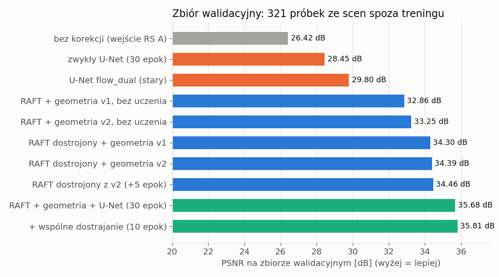
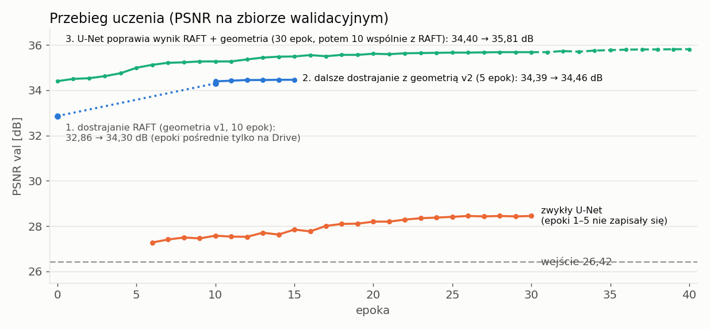
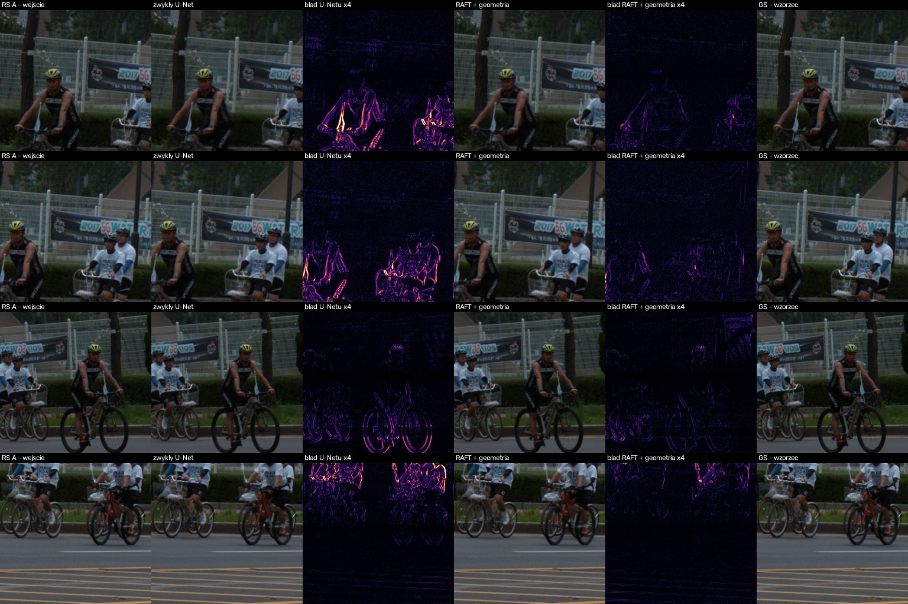
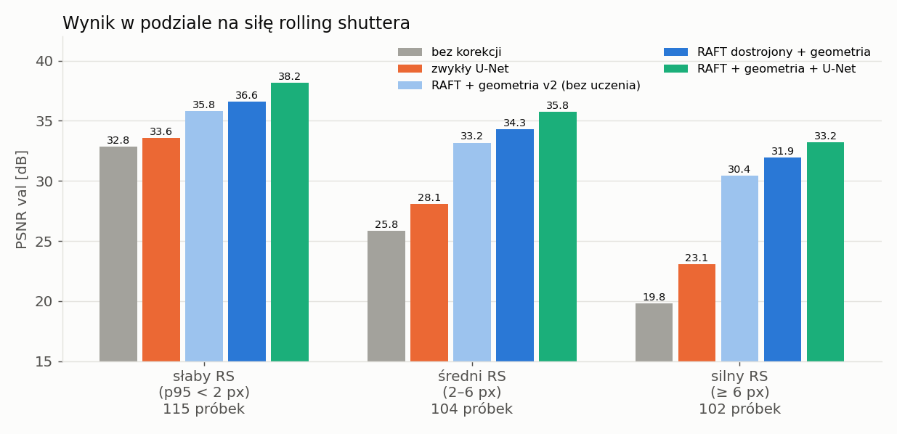
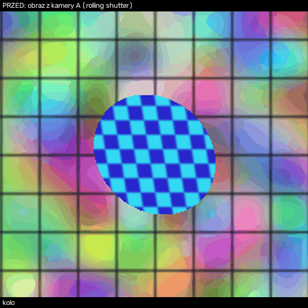
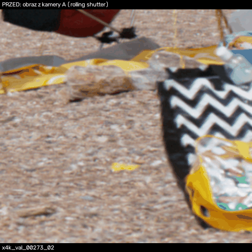
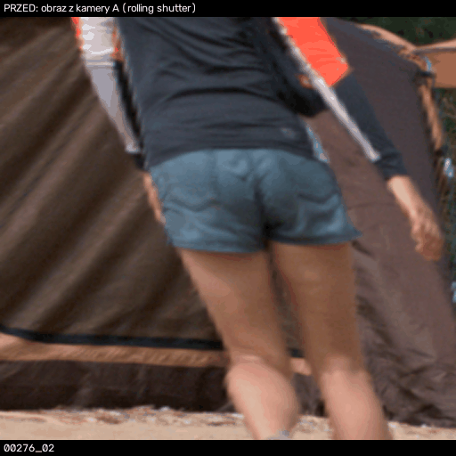

# Wstępne wyniki: korekcja rolling shutter z dwóch kamer (RAFT + geometria + U-Net)

Stan na 2026-11-08. Wszystkie liczby to PSNR na **zbiorze walidacyjnym** (321 próbek ze scen,
których nie było w treningu), liczony w obszarze widocznym w kamerze A.

## 1. Problem i pomysł

- **Kamera A** czyta obraz wierszami (od góry do dołu), **kamera B** jest obrócona o 90°, więc w kadrze A czyta kolumny.
  Odczyt całej klatki trwa 10–30 ms, więc ruchome obiekty wychodzą pochylone lub rozciągnięte (rolling shutter, RS).
- Ten sam punkt sceny każda kamera fotografuje **w innej, znanej chwili** (wynika z numeru wiersza i kolumny).
- Cel: z pary obrazów RS (A, B) odtworzyć obraz kamery A tak, jakby był zrobiony w jednej chwili (global shutter, GS).

## 2. Metoda

1. **RAFT** (gotowa sieć do przepływu optycznego) znajduje dla każdego piksela obrazu A ten sam punkt w obrazie B.
2. **Geometria** (zwykłe obliczenia, bez uczenia): prędkość punktu = przesunięcie między A i B / różnica czasów odczytu.
   Znając prędkość, cofamy każdy piksel A do jednej wspólnej chwili.
3. **Dostrajanie**: uczymy tylko RAFT, z błędu obrazu wynikowego względem wzorca GS (geometria stała).
4. **Geometria v2** (2026-11-03) poprawia krawędzie ruchomych obiektów: na krawędzi wybiera obiekt, a nie tło,
   a miejsca, których kamera A nie widziała (zasłonięte w chwili odczytu wiersza), bierze z kamery B.
5. **U-Net na końcu** (2026-11-08): mała sieć (2,7 mln wag) dostaje obraz A i obraz B przesunięte geometrią
   do jednej chwili. Poprawia oba przesunięcia o kilka pikseli, dla każdego piksela wybiera proporcję A i B
   (maska) i dodaje drobną poprawkę jasności.
   Najpierw uczy się sam U-Net (RAFT zamrożony, 30 epok), potem 10 epok razem z RAFT.

Kod: `src/raft_geom.py`, `src/raft_unet.py`, uczenie `src/train_raft.py`, `src/train_unet.py`,
notatniki Colab `04_raft_geom`, `05_unet`, `07_demo_v2`.

## 3. Dane

Zbiór `rs_video_x4k`: obrazy RS złożone z nagrań 1000 kl./s (X4K1000FPS). Każdy wiersz (kolumna) pochodzi z klatki
nagranej w chwili jego odczytu, a wzorzec GS to jedna klatka. **2397 próbek treningowych, 321 walidacyjnych,**
podział po scenach. Odczyt 10–30 ms, obrazy 256×256. Opis: `docs/zbior_rs_video_x4k.md`, analiza: `docs/analiza_zbioru_agent.md`.

## 4. Wyniki

| model | PSNR [dB] | SSIM | uwagi |
|---|---|---|---|
| bez korekcji (wejście RS A) | 26,42 | 0,795 | punkt odniesienia |
| zwykły U-Net (A, B, czasy odczytu → obraz) | 28,45 | 0,845 | 30 epok, od zera |
| U-Net `flow_dual` (stary model z etapu 1) | 29,80 | 0,885 | |
| RAFT + geometria v1, **bez uczenia** | 32,86 | 0,936 | gotowe wagi RAFT |
| RAFT + geometria v2, bez uczenia | 33,25 | 0,937 | |
| RAFT dostrojony (10 epok) + geometria v1 | 34,30 | 0,941 | lr 2e-5, bs 8 |
| ten sam RAFT + geometria v2 | 34,39 | 0,941 | bez dodatkowego uczenia |
| RAFT dostrojony dalej z geometrią v2 (+5 epok) | 34,46 | 0,941 | lr 1e-5, ~219 s/epokę na L4 |
| RAFT (zamrożony) + geometria + U-Net | 35,68 | 0,955 | 30 epok, lr 3e-4, 56 s/epokę na L4 |
| **RAFT + geometria + U-Net, wspólne dostrajanie (+10 epok)** | **35,81** | **0,955** | RAFT lr 1e-5, U-Net lr 1e-4, 126 s/epokę |

Wnioski:
- **Najlepszy model: RAFT + geometria + U-Net, 35,81 dB** (+9,4 dB względem wejścia). U-Net dodaje +1,35 dB
  do najlepszego RAFT + geometrii (34,46 dB). Poprawia 303 z 321 próbek walidacyjnych.
- **Geometria daje większość zysku bez żadnego uczenia** (+6,4 dB). Dostrojenie RAFT dodaje +1,4 dB i nasyca się
  po kilku epokach; dalsze 5 epok z geometrią v2 dodało już tylko +0,07 dB.
- **Zwykły U-Net uczy się słabo** (+2 dB po 30 epokach): musiałby sam nauczyć się szukać tego samego punktu
  w obu obrazach na odległość 10–40 px. RAFT robi to od razu, a geometria zamienia to na korekcję.
- Geometria v2 daje na całym zbiorze tylko +0,1–0,4 dB, bo poprawia wyłącznie krawędzie ruchomych obiektów,
  a ok. 1/3 próbek prawie nie ma ruchu. Na krawędziach różnica jest wyraźna (koło: 26,9 → 29,1 dB).
- Średnia na całym zbiorze zaniża efekt: w ok. 1/3 próbek RS jest słaby, więc wejście ma już wysoki PSNR.
  Podział na siłę RS: sekcja 5.
- U-Net poprawia też brzegi kadru widoczne tylko w kamerze B: PSNR całego obrazu 33,69 → 35,37 dB (+1,7 dB).
  Średnia waga kamery B w masce to ok. 0,4 (na starcie uczenia 0,12).
- Wspólne dostrajanie RAFT i U-Net dało już tylko +0,14 dB: model jest nasycony na tym zbiorze.
- U-Net w notatniku 05 korzysta wewnętrznie z geometrii v1 (kod z gałęzi `main`, commit `d70c697`) i RAFT
  dostrojonego z geometrią v2. Sam ten etap daje 34,36 dB, a z U-Netem 35,68 dB.

Te same 4 próbki walidacyjne, mapy błędu w tej samej skali (×4): zwykły U-Net vs RAFT + geometria (dostrojony, v2).

## 5. Wynik w podziale na siłę rolling shuttera

Klasy z analizy zbioru: 95. percentyl przesunięcia pikseli przez RS (słaby < 2 px ≤ średni < 6 px ≤ silny).
RAFT bez dostrajania liczony lokalnie (`data/analiza_agent/eval_klasy.csv`); wynik dla całego zbioru (32,86 dB dla v1)
zgadza się z Colabem. Zwykły U-Net z notatnika 06. RAFT dostrojony + geometria oraz RAFT + geometria + U-Net
z notatnika 05 (wyniki dla każdej próbki z `val_per_sample.csv`, kopia w `data/analiza_agent/eval_refine.csv`).

| siła RS | próbek | wejście | zwykły U-Net | RAFT + v1 | RAFT + v2 | RAFT dostrojony + geometria | **RAFT + geometria + U-Net** | zysk |
|---|---|---|---|---|---|---|---|---|
| słaby (p95 < 2 px) | 115 | 32,82 | 33,58 | 35,72 | 35,82 | 36,58 | **38,18** | +5,4 |
| średni (2–6 px) | 104 | 25,84 | 28,05 | 32,64 | 33,18 | 34,29 | **35,76** | +9,9 |
| silny (≥ 6 px) | 102 | 19,78 | 23,08 | 29,85 | 30,43 | 31,93 | **33,20** | +13,4 |

**Im silniejszy rolling shutter, tym większy zysk:** przy silnym RS cały model poprawia obraz o 13,4 dB,
a zwykły U-Net o 3,3 dB. U-Net na końcu dodaje podobnie w każdej klasie (+1,3 do +1,6 dB), czyli poprawia
głównie drobne błędy, które zostają po geometrii. Geometria v2 pomaga najbardziej przy silnym ruchu (+0,6 dB względem v1).

## 6. Demo

Kolumny obrazów: RS A (wejście) | RS B (wejście, obrócony do orientacji A) | **wynik** | wzorzec GS | stara geometria (v1).
GIF-y pokazują na przemian obraz z kamery A (przed) i wynik (po). Model: gotowy RAFT + geometria v2
(bez dostrajania, liczone lokalnie); wersja z dostrojonym modelem: `z_colaba/demo_dostrojony_v2.*`.
Demo nie używa jeszcze U-Netu z sekcji 4 (`src/demo.py` obsługuje na razie tylko RAFT + geometrię).

| przykład | co to jest | wejście | wynik | dostrojony RAFT |
|---|---|---|---|---|
| koło | syntetyczne koło w kratkę jadące w prawo 2 px/ms, odczyt 20 ms (`examples/kolo`) | 22,8 dB | 29,1 dB | 29,3 dB |
| torba | próbka walidacyjna `val/00273_02`, ruch obiektów | 14,9 dB | 27,8 dB | 28,4 dB |
| kobieta | próbka walidacyjna `val/00276_02`, idąca osoba | 14,4 dB | 29,2 dB | – |

**Koło** (wygięte → okrągłe):

**Torba w zygzaki** (`val/00273_02`):

**Idąca kobieta** (`val/00276_02`): w RS cała postać jest przechylona, po korekcji stoi prosto.

Pełne porównania (wszystkie kolumny): `demo/*.jpg`. Demo uruchamia się jedną komendą:
`python src/demo.py examples/kolo examples/x4k_val_00273_02 --compare-v1 --out demo.png --gif demo.gif`.

## 7. Ograniczenia i dalsze kroki

- **Pas na antyprzekątnej**: tam obie kamery czytają punkt w tej samej chwili, więc prędkości nie da się zmierzyć
  i jest uzupełniana z sąsiedztwa. Daje drobne błędy w środku kadru.
- **Miejsca niewidziane przez żadną kamerę** (cienki sierp przy krawędzi szybkiego obiektu) zostają błędne;
  przy dużych obszarach z kamery B widać czasem szew.
- **Szybki obrót** (wiatrak > ~100 obr/min): geometria zakłada ruch po prostej w czasie odczytu; przy obrocie
  o kilkadziesiąt stopni w czasie odczytu to założenie przestaje działać. Zbiór X4K prawie nie ma ruchu obrotowego.
- **Dane syntetyczne**: brak paralaksy zależnej od głębi, brak rozmycia ruchu, mały zakres przesunięcia startu kamer (±2 ms).
- **U-Net** nie naprawi tego, czego nie widzi żadna kamera; zgaduje te miejsca z otoczenia. Model działa wolniej:
  ok. 52 ms na parę obrazów 256×256 na GPU L4 (RAFT + geometria + U-Net, sam czas sieci).
- Następne kroki: demo z U-Netem, U-Net na geometrii v2 (dziś v1) i test na prawdziwej parze kamer (wiatrak),
  w tym sprawdzenie kierunku obrotu kamery B.
